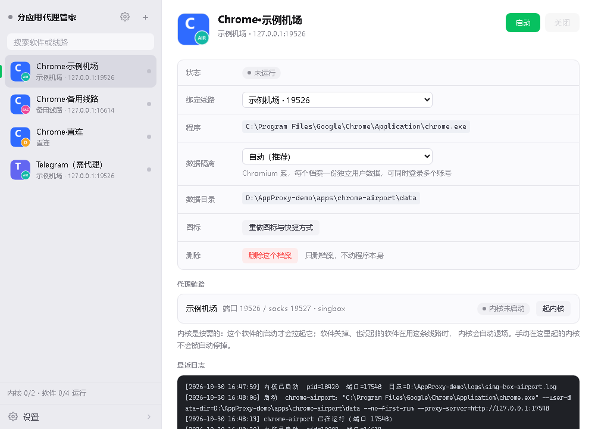
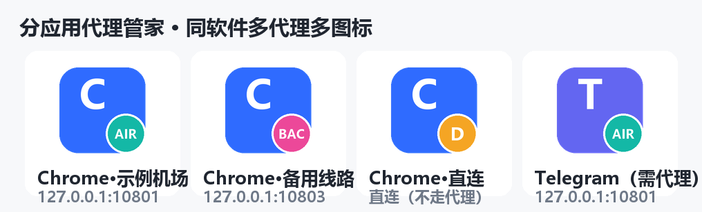
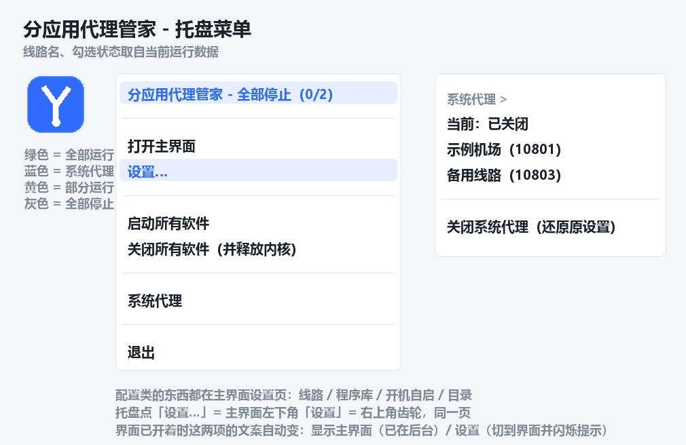
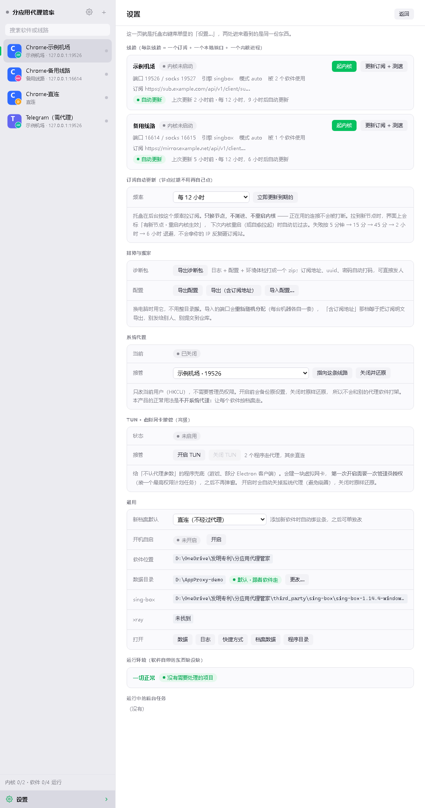
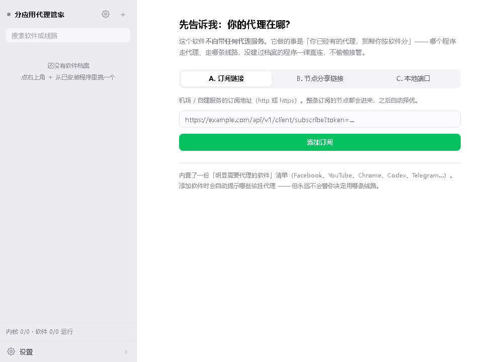
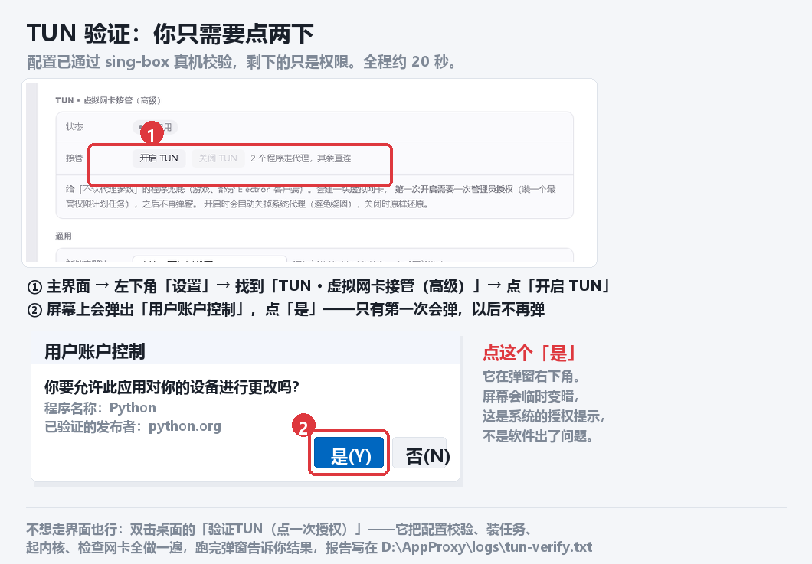

# APPVPN — Per-App Proxy Manager for Windows

> **Language / 语言**：English (current) ｜ [简体中文](README.zh-CN.md)

**Turn "whole-machine proxy" into "per-app proxy".** Route any Windows program —
or just one window of it — through its own proxy line, with its own isolated
data and its own desktop icon. Same app, multiple copies, each through a
different exit, without interference.

Windows desktop tool. Python + sing-box. Free, no ads, no telemetry.

> Version 0.7.1 ｜ Windows 10 / 11 ｜ **No Python, no dependencies, no scripts needed** — download and run.
>
> | Flavor | File | How to use |
> |---|---|---|
> | **Installer** (recommended) | `AppProxy-v<ver>-win64-setup.exe` | Double-click → next → pick install folder → done |
> | **Portable** (USB-friendly) | `AppProxy-v<ver>-win64.zip` | Unzip anywhere → double-click `AppProxy.exe` |
>
> Grab it from [Releases](../../releases). Missing runtime libraries? The app detects them and offers one-click fixes.



---

## Why

| Scenario | Global tools (v2rayN / Clash) | APPVPN |
|---|---|---|
| Who gets proxied | The whole machine (system proxy or TUN) | Just the apps you pick — even a single window |
| Multiple copies of one app | Not possible (one process, one config) | One icon per "app × line", several at once |
| Switching lines | Global switch, affects everything | Only affects the icon bound to that line |
| Core (kernel) | Tied to the client | Pluggable: sing-box (default) / xray (legacy lines) |
| While idle | Core stays resident, holding memory & connections | Zero cores running when nothing uses them |

Typical use: three Chrome windows — one for research abroad, one browsing domestic
sites directly, one scraping in the background. Three windows, three lines, zero
interference.



---

## Three core concepts

| Concept | What it is | Stored in |
|---|---|---|
| **Line** | A subscription or local proxy port + a local HTTP/SOCKS port pair + one core process | `lines.json` |
| **Profile** | "One app × one line": which exe to launch, with what args, which data folder, which icon | `profiles.json` |
| **Pool** | Registry of on-demand cores. Started when an app needs it, reclaimed when nothing does | `pool.json` |

**You start apps, not lines.** Clicking *Start* spins up only the line this app is
bound to (~1 second measured) — no speed test, no warm-up, no touching other lines.
Close the app window, and within 5 seconds the backend notices nobody uses that
line and the core exits by itself.

---

## Features

**Proxy**
- Subscription parsing: vless / vmess / trojan / shadowsocks, with ws / grpc / h2 / httpupgrade / xhttp, TLS / REALITY
- Auto-select: `urltest` on a timer, or pin one specific node
- **Subscription auto-update**: the tray pulls subscriptions on a schedule (default 12 h) —
  **swaps nodes only, never speed-tests, never restarts the core**, so live connections
  stay up. New nodes take effect on the next core restart; failures back off
  5 min → 15 min → 45 min → 2 h → 6 h.
- First-time config probes node reachability and only uses working nodes
- Batch speed test, health check, single-node probing
- **Pin the fastest node**: one button speed-tests every node on a line and pins the
  fastest as the exit — your IP stays stable instead of rotating with the subscription

**Per-app**
- **Ready out of the box**: on first start, Telegram / WhatsApp / Messenger / Facebook /
  Instagram / X / YouTube are pinned to the sidebar. **No app binaries bundled**: if the
  desktop app is installed we point at it; otherwise you get a web-app entry (a dedicated
  browser profile that opens the site directly, fully isolated from your daily browser).
- **Follow the default line**: those seven are bound to the "default line" — import a
  subscription and they attach automatically, no per-app editing.
- **Deleted stays deleted**: presets you remove are remembered and never grow back on
  upgrade; restore them anytime from Settings.
- **One-click popular apps**: a built-in catalog of 73 apps (Telegram / WhatsApp / Discord /
  Slack / Netflix / Spotify / ChatGPT / Claude / Notion / Steam…). Installed → one click
  creates a profile; not installed → official download link.
- Web-only mode: an isolated browser profile (`--user-data-dir`) that goes straight to the site.
- Pick from installed programs (Start-menu scan: ~190 programs in ~2 s; portable / Store
  builds get registry + shallow-scan fallback; Store versions are detected and flagged —
  they ignore proxy parameters).
- Browsers get `--user-data-dir` + `--proxy-server`; other programs get
  `HTTP_PROXY` / `HTTPS_PROXY` environment variables.
- **True multi-instance isolation**: each profile gets its own user data
  (`apps\<profile>\data`). Chromium/Electron use `--user-data-dir`, Telegram `-workdir`,
  Firefox/Thunderbird `-profile` + `-no-remote`. Apps we don't know never get force-fed
  arguments — the UI tells you plainly.
- Auto-generated badges on icons (initial letter + line color) and desktop shortcuts
- **Bilingual UI**: English and Chinese, one click to switch (top-left button); the tray
  menu follows your choice. Defaults to your browser language.

**UI**
WeChat-style main window: app list on the left, details on the right, settings in the
same window — not buried in tray menus.

| Tray | Settings |
|---|---|
|  |  |

**First-run onboarding**
With zero lines configured, the main window asks "where is your proxy?" instead of
showing an empty screen:



| Option | For |
|---|---|
| Subscription URL | Airport / self-hosted — the common case |
| Share link | Single node (`vless://` `vmess://` `trojan://` `ss://`) |
| Local port | v2rayN / Clash already running on this machine — just the port (we probe it first) |

**Stability**
- **Random port allocation**: every line gets a random local port pair in `15002–19998`,
  steering clear of reserved ranges (Hyper-V / WSL) and proxy tools' legacy ports
  (1080, 7890, 10800–10999). No more "core won't start" because two tools grabbed the same number.
- **Core self-healing**: a crashed core is brought back automatically — deliberately
  slow to judge (48 s of continuous absence) so a slow start never triggers a false
  recovery; retries back off 60 → 120 → 240 → 300 s.

**Troubleshooting & moving**
- **Diagnostics package**: one button (`AppProxy.exe diag`) zips the doctor report,
  line/profile snapshots, port history, recent logs and the compiled core config.
  **Subscription URLs keep only the host; uuids / passwords / reality keys are redacted**,
  and the package self-checks before handing to you — paste it straight into an issue.
- **Config export / import**: `export [--with-sub]` / `import <file>`. Carries line
  definitions and profiles only — **ports are never exported** (re-randomized per machine),
  node caches and machine-local traces are dropped.

**System-level**
- System-proxy takeover: writes `HKCU` + broadcasts, **backs up before, restores exactly
  after** (no admin needed) — and the toggle is opt-in, never automatic.
- Autostart: a shortcut in the Startup folder, no scheduled tasks.
- TUN virtual-adapter takeover (advanced, off by default).

**TUN fallback (advanced)**
For apps that ignore proxy parameters (games, some Electron clients, updaters). Creates
a virtual adapter, catches all traffic, then routes by process name. One admin approval, never asks again.



---

## Quick start

### Option 1: Installer (recommended)

1. Download `AppProxy-v<ver>-win64-setup.exe` from [Releases](../../releases)
2. Double-click, next, next — **pick your own install folder** (D: drive works fine)
3. Shows up in Start menu and on the desktop; uninstalls normally from Control Panel

Data lives in the install folder (`<install>\AppProxyData\`) by default — no extra
questions. Move it later via Settings → Data folder; existing config is copied over.

Installs per-user, **zero UAC prompts**; choose "install for all users" on the first
page if you want it machine-wide. Uninstall asks whether to also remove config and
logs — default is **keep**.

### Option 2: Portable

1. Download `AppProxy-v<ver>-win64.zip` from [Releases](../../releases)
2. Unzip anywhere (local disk, USB drive)
3. Double-click `AppProxy.exe`

A `portable.txt` marker makes data live in `AppProxyData\` next to the exe:

- Move the whole folder anywhere — new drive letter, new PC — config and subscriptions follow
- Delete the folder when done; nothing is left behind
- The only dependency is Windows 10/11 itself

First launch opens the onboarding page — paste a subscription URL or point at an
existing client's local port.

### Missing runtime libraries?

The app self-checks on start. Settings page has a **Runtime** section: what's missing,
listed plainly, each with a fix button (VC++ redistributable → official Microsoft
installer; TUN driver → auto-patched into the core folder). CLI works too:
`AppProxy.exe doctor` (add `--fix vc_runtime` / `--fix wintun`).

### From source (developers)

```bat
git clone <this repo>
cd <repo>

scripts\setup.bat      :: Python deps only — cores ship with the repo
scripts\start_tray.bat :: tray icon
```

### Building packages

```bat
python scripts\build_release.py              :: portable + installer
python scripts\build_release.py --zip        :: portable only
python scripts\build_release.py --installer  :: installer only
```

Outputs to `dist\`. The installer needs [Inno Setup 6](https://jrsoftware.org/isdl.php)
once (`winget install JRSoftware.InnoSetup`); without it, only the zip is built — no errors.

---

## Daily use

1. Double-click `AppProxy.exe` → tray appears (**nothing is warmed up**)
2. Double-click the tray icon → main window
3. Pick an app on the left → **Start** → its line's core starts (~1 s) → the app opens through the proxy
4. Done? Just close the app. Within 5 s the backend reclaims the core.
5. New app: **＋** → pick from installed programs → choose its line → **Add**

The tray menu has 6 items, period. Everything else lives in the main window.

---

## Architecture

```
                     ┌──────────────────────────────────────┐
   Tray (pystray)  ──┤                                      │
                     │   appproxy/                          │
   Main window      │   ├─ cli.py         CLI entry        │
   (Chrome --app) ───┤   ├─ tray.py        tray & actions   │
        │            │   ├─ gui.py         local HTTP + shell
        │            │   ├─ webui/api.py   FastAPI endpoints│
        │            │   └─ webui/static/index.html  SPA    │
        │            │                                      │
   HTTP 127.0.0.1:<random port>                           │
                     └───────────────┬──────────────────────┘
                                     │
        ┌────────────────┬───────────┴──────────┬────────────────┐
        │                │                      │                │
   subscription.py    pool.py             procwatch.py      sysproxy.py
   sub → nodes       on-demand cores      process watch     system proxy
        │                │                      │            (backup/restore)
   singconf.py /    coreproc.py                 │
   xrayconf.py      start/stop/probe            │
        │                │                      │
        └────────┬───────┘                      │
                 │                              │
        sing-box / xray (separate process)   profiles.py / launcher.py
        process_name routing, urltest        how "app × line" launches
```

| Module | Role |
|---|---|
| `models.py` | node/line structures, xray outbound generation |
| `subscription.py` | fetch subscriptions, parse share links |
| `singconf.py` / `xrayconf.py` | config generation, validated by `sing-box check` / `xray test` |
| `coreproc.py` | core start/stop, port probing, live checks through the proxy |
| `registry.py` | `lines.json` + node snapshots |
| `profiles.py` / `launcher.py` | profile store, launch commands, proxy injection, **isolation** |
| `procwatch.py` | is the app still running (Chromium matched precisely via `--user-data-dir`) |
| `pool.py` | on-demand core pool: registration, reclaim (60 s grace), GC |
| `autosub.py` | subscription auto-update: due checks, backoff, mark-don't-restart |
| `diag.py` | diagnostics package: zip + **credential redaction** + self-check |
| `transfer.py` | config import/export: no ports, no machine traces, orphan profiles → direct |
| `icons.py` / `shortcut.py` | multi-size `.ico`, `.lnk` (win32com first, pylnk3 fallback with verification) |
| `sysproxy.py` / `autostart.py` | system proxy takeover & restore, autostart |
| `appscan.py` / `appdb.py` | Start-menu scan, 73-app catalog & recommendations |
| `preset.py` | first-run pinned apps, deletion memory, no auto-respawn |
| `appfind.py` | "where is this app installed": registry → index → shallow scan, Store excluded |
| `tunconf.py` / `tunmgr.py` / `elevate.py` | TUN config, start/stop, one-time elevation |
| `setup.py` | first-run onboarding (subscription / share link / local port) |

---

## Design decisions

1. **Parameter injection is the main path; TUN is the fallback.** Injection needs zero
   privileges and no driver; TUN covers everything but needs admin and can trip
   anti-cheat. Off by default.
2. **One profile owns one port pair.** sing-box `process_name` rules can't tell two
   instances of the same exe apart — so multi-instance is per-profile ports, not process names.
3. **Cores are on-demand.** "Start all" would just be a slower v2rayN. Start spins up one
   line (~1 s); close reclaims within 5 s. Manually started cores are never auto-reclaimed.
4. **System proxy is borrowed, not owned.** Original value is backed up and written back
   verbatim; `ProxyOverride` always skips local addresses (or the app locks itself out).
5. **TUN's four iron rules**: unregistered programs go direct; only bound processes proxy;
   enabling TUN turns the system proxy off (restored after); **no kill-switch** — a flaky
   core must never take the whole machine offline. Elevation happens once via a triggerless
   scheduled task; TUN config is always validated with `sing-box check`.
6. **The window is Chrome/Edge `--app` mode.** pywebview sometimes fails to a blank screen
   with no error; `msedge --app=<local url> --user-data-dir=...` has no address bar, closes
   cleanly, and closing it is a signal. pywebview stays available via `--native`.
7. **Tray and window are separate processes, handshaking via a landmark file.** The actual
   UI port is recorded in `gui.port`; `/api/ping` returns `app=appproxy` so we never send
   commands into someone else's service on the same port.

---

## Privacy & security

- **Everything stays local** (`APPPROXY_HOME` moves the data root). No cloud account, no telemetry.
- **Subscription URLs carry tokens, so the repo contains zero line data**: `data/` is empty;
  first launch shows onboarding.
- **System proxy is restorable**: backed up before takeover, written back after.
- **No kill-switch**: better a brief leak than a dead machine.
- **We don't pick providers for you**: this tool does per-app routing; the lines are yours.

---

## Repository layout

```
APPVPN/
├─ appproxy/                 source
│  ├─ webui/
│  │  ├─ api.py              FastAPI endpoints
│  │  └─ static/index.html   single-page frontend (no framework)
│  ├─ preflight.py           runtime checks + one-click fixes
│  ├─ selfrun.py             relaunch self in source / frozen mode
│  ├─ settings.py            path resolution (portable / installed / fallback)
│  ├─ i18n.py                zh/en string layer (tray side)
│  └─ data/apps_need_proxy.json  the "obviously needs proxy" catalog
├─ scripts/                  setup.bat / start_tray.bat / build_release.py / fetch_engine.py
├─ packaging/                PyInstaller spec + exe entry + Inno Setup script
├─ tests/                    unit tests + live end-to-end scripts
├─ tools/verify_tun.py       TUN one-click self-test
├─ docs/                     screenshots & dev notes
├─ third_party/              sing-box core + wintun driver (ships with the repo)
└─ requirements.txt
```

Data location **follows the app**, never a hard-coded drive:

| Flavor | Data default | Change it |
|---|---|---|
| Installer | `<install>\AppProxyData\` | Settings → Data folder |
| Portable | `<unzip>\AppProxyData\` | same |
| Source | `D:\AppProxy` if a D: drive exists, else `%LOCALAPPDATA%\AppProxy` | `APPPROXY_HOME` env var |

---

## CLI reference

```bat
:: Lines
python -m appproxy.cli add --id myproxy --name "My airport" --sub "<subscription url>"
python -m appproxy.cli update myproxy          :: fetch subscription
python -m appproxy.cli nodes  myproxy          :: list nodes
python -m appproxy.cli ping   myproxy --top 10 :: speed test
python -m appproxy.cli ping   myproxy --select :: test & pin the fastest
python -m appproxy.cli build  myproxy --probe  :: build config (probed nodes only)
python -m appproxy.cli start  myproxy
python -m appproxy.cli stop   myproxy

:: Profiles
python -m appproxy.cli profile suggest            :: catalog: installed? created?
python -m appproxy.cli profile add --app telegram --line myproxy
python -m appproxy.cli profile add --app facebook --line myproxy --web   :: web-only
python -m appproxy.cli profile add --name "Chrome-A" --exe "C:\...\chrome.exe" --line myproxy
python -m appproxy.cli profile add --name "Chrome-B" --exe "C:\...\chrome.exe" --line myproxy
python -m appproxy.cli profile set chrome-b --isolate off     :: disable data isolation
python -m appproxy.cli profile set chrome-b --line @default  :: bind to the default line
python -m appproxy.cli profile launch chrome-a
python -m appproxy.cli profile launch chrome-a --client       :: desktop app instead of web
python -m appproxy.cli profile list

:: Pinned presets (created automatically on first start)
python -m appproxy.cli preset                    :: what exists, what's missing
python -m appproxy.cli preset --restore          :: restore missing ones

:: UI & tray
python -m appproxy.cli gui                       :: main window
python -m appproxy.cli gui --view settings       :: land on Settings
python -m appproxy.cli tray                      :: tray (foreground, debug)

:: System level
python -m appproxy.cli sysproxy enable <port>
python -m appproxy.cli sysproxy restore
python -m appproxy.cli autostart on|off
python -m appproxy.cli tun start|stop|status|remove
python -m appproxy.cli appdb find chrome.exe     :: does this app need a proxy?

:: Auto-update / diagnostics / moving
python -m appproxy.cli auto                      :: per-line update status
python -m appproxy.cli auto --interval 6         :: every 6 h (--off to disable)
python -m appproxy.cli auto --run                :: refresh due lines now
python -m appproxy.cli diag                      :: diagnostics package (redacted)
python -m appproxy.cli export --out cfg.json     :: export config (no subscription URLs)
python -m appproxy.cli import cfg.json --fetch   :: import and fetch subscriptions
```

---

## Tests

```bat
python -m pytest tests -q
```

**302 unit tests** pass. `tests\` also ships live end-to-end scripts (they really start
cores, open windows, write registry — read the comments first):

| Script | Verifies |
|---|---|
| `live_dispatch.py` | subscription → config → core → request through proxy |
| `live_profile.py` | profile launch, `--user-data-dir` isolation |
| `live_shortcut.py` | shortcuts & icons |
| `live_sysproxy.py` | system proxy takeover & exact restore |
| `live_ondemand.py` | on-demand core start/stop & reclaim |
| `live_view.py` | UI endpoints, deep links, `--shot` screenshots |
| `live_window.py` | real window: tray → switch view + taskbar flash |
| `live_setup.py` | empty data → onboarding → create line → prompt gone |
| `verify_tun.py` | full TUN chain (one admin approval) |

---

## Known limitations

- **Windows only** (`pystray` / `pywin32` / registry-based system proxy).
- **Two instances of the same exe can't be told apart by process name**: browsers are
  separated per-profile (`--user-data-dir` + `--proxy-server`); other apps rely on
  `process_name` rules; two profiles on the same line share that line's ports.
- **TUN needs one admin approval**, and some anti-cheat games block virtual adapters.
- **No built-in nodes, no provider recommendations.** Without a line, apps go direct.
- **The window needs Chrome or Edge** (`--app` mode); otherwise falls back to the default
  browser + `--native` (requires pywebview).
- **Not a single-file exe**: `.exe` and `_internal\` must stay together — move the folder, not the file.

---

## Third-party components & licenses

| Component | Version | License | Usage |
|---|---|---|---|
| [sing-box](https://github.com/SagerNet/sing-box) | 1.14.4 | GPL-3.0-or-later | separate exe, separate process, **unmodified** |
| [xray-core](https://github.com/XTLS/Xray-core) | 26.6.1 | MPL-2.0 | same, for legacy lines |

Because cores are invoked as unmodified separate processes (no static linking), this
project's own code stays MIT. Distribution includes the upstream LICENSE files —
see [`third_party/来源与许可.md`](third_party/来源与许可.md).

---

## License

MIT — free to use, modify, redistribute, even commercially; keep the copyright and
license notice. Bug fixes as PRs are always welcome.

Third-party components keep their own licenses (sing-box GPL-3.0-or-later as a separate
unmodified process; Wintun per its bundled `wintun-LICENSE.txt`).

This software is free, ad-free, telemetry-free, and never uploads local data.
