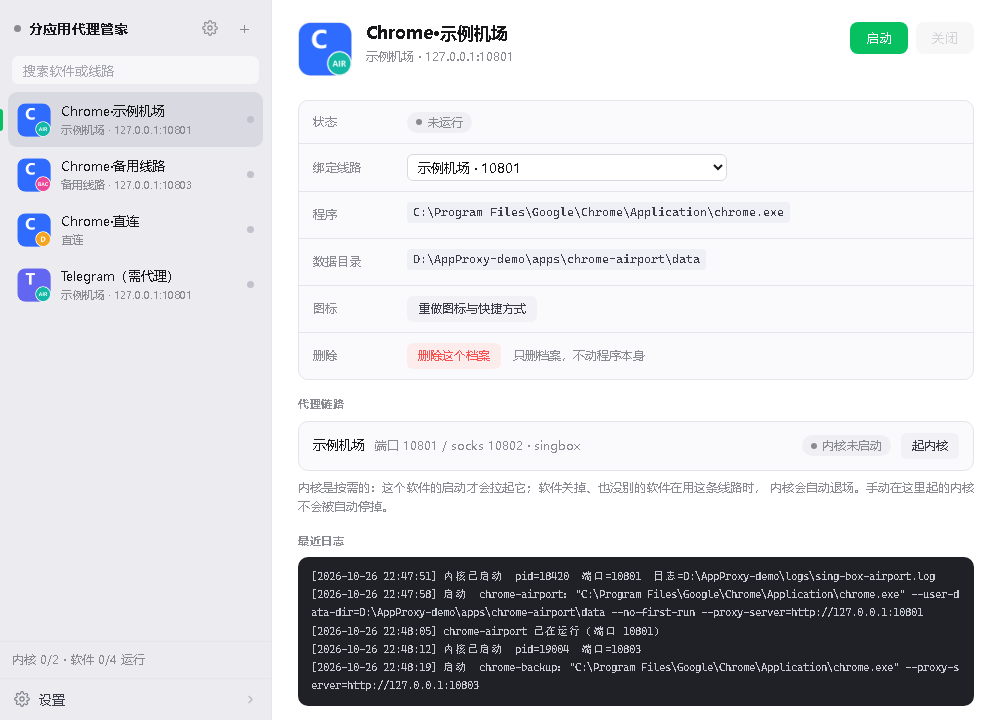
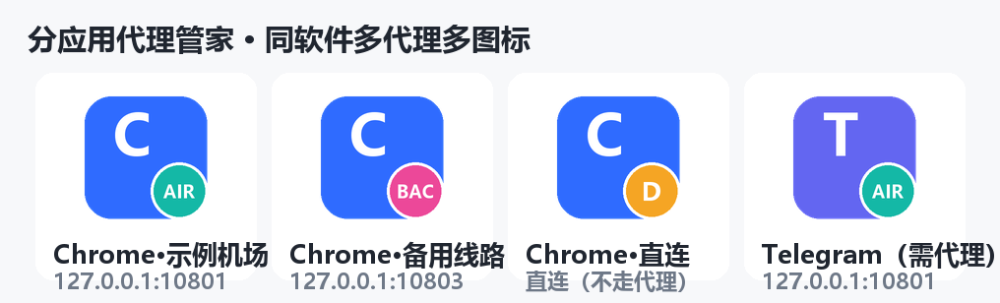
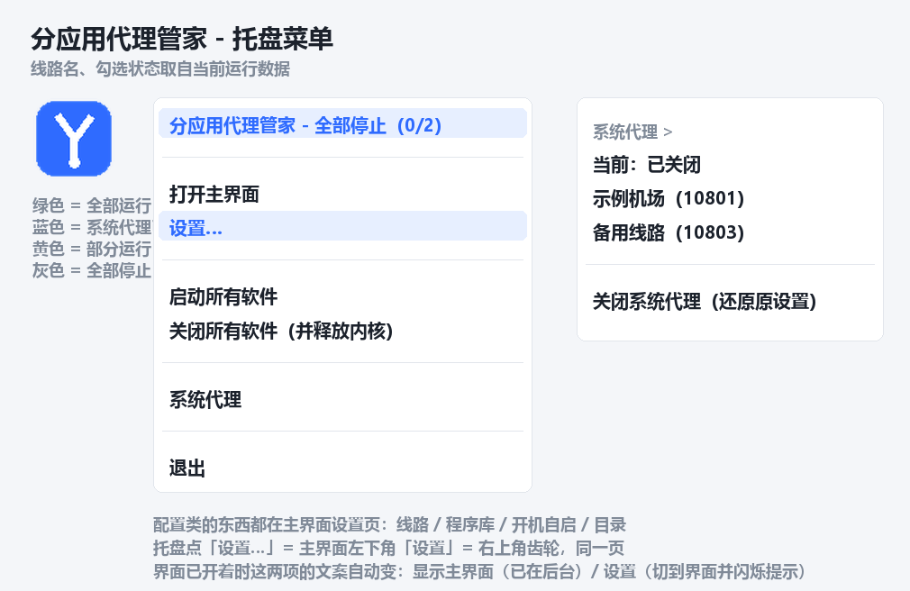
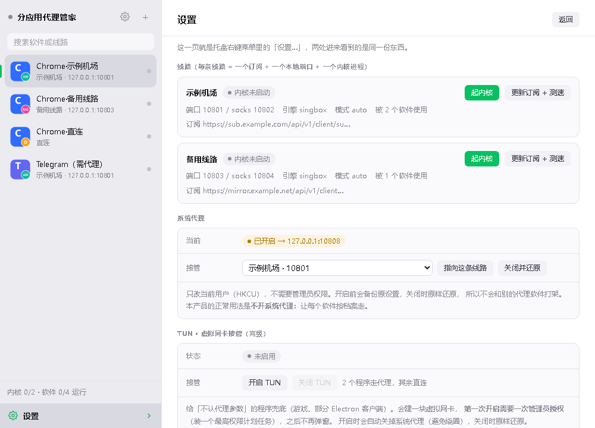
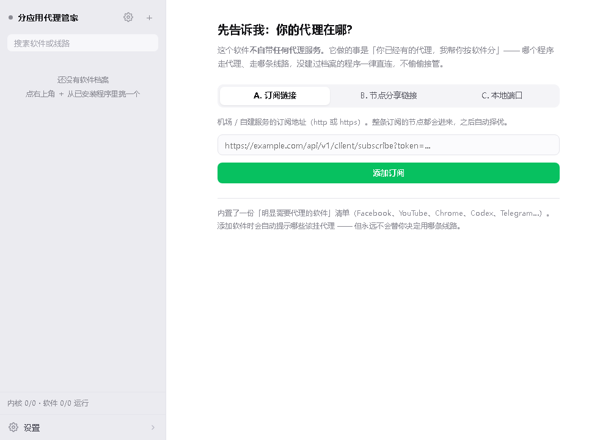
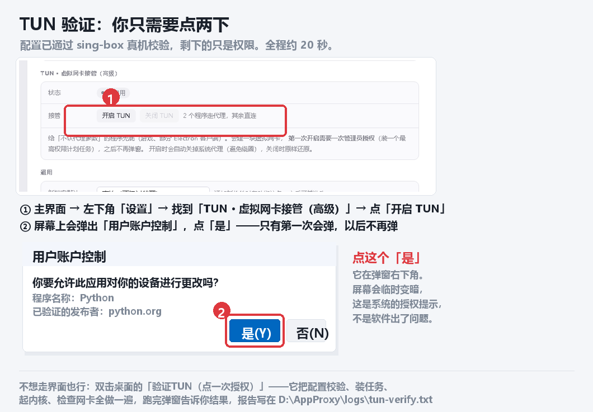

# 分应用代理管家

**把「全机代理」拆成「按程序代理」。**

同一个软件可以开多个图标、各走不同线路，互不干扰；线路只在它对应的那个程序启动时才起来，程序关掉就自动退场。Windows 桌面工具，Python + sing-box。

> 版本 0.5.0 ｜ 平台 Windows 10 / 11 ｜ 相关技术方案正在准备发明专利申请



---

## 目录

- [它解决什么问题](#它解决什么问题)
- [三个核心概念](#三个核心概念)
- [功能一览](#功能一览)
- [快速开始](#快速开始)
- [日常怎么用](#日常怎么用)
- [技术架构](#技术架构)
- [关键设计取舍](#关键设计取舍)
- [隐私与安全](#隐私与安全)
- [目录结构](#目录结构)
- [命令行速查](#命令行速查)
- [测试](#测试)
- [已知限制](#已知限制)
- [第三方组件与许可](#第三方组件与许可)
- [版权声明](#版权声明)

---

## 它解决什么问题

| 场景 | v2rayN / Clash 这类全局软件 | 本软件 |
|---|---|---|
| 谁走代理 | 全机器（系统代理或虚拟网卡） | 你指定的那个程序，甚至只是它的一个窗口 |
| 同一个软件多开 | 做不到（一个进程一套设置） | 一个「软件 × 一条线路」一个图标，可同时开多个 |
| 换线路 | 全局切换，影响所有软件 | 只影响绑定了这条线路的那个图标 |
| 内核 | 绑定具体客户端 | 可插拔：sing-box（主）/ xray（兼容旧线路） |
| 平时待机 | 内核常驻，一直占内存和连接 | 没有程序在用时，一个内核都不起 |

典型用法：Chrome 开着三个窗口，一个查境外资料、一个刷国内站点直连、一个跑后台抓取，三个窗口各走各的线路，互不影响，也不会互相拖慢。



---

## 三个核心概念

| 概念 | 是什么 | 存在哪 |
|---|---|---|
| **线路（Line）** | 一条订阅或一个本地代理端口 + 一对本地端口（HTTP/SOCKS）+ 一个内核进程 | `lines.json` |
| **档案（Profile）** | 「一个程序 × 一条线路」的组合：要启动哪个 exe、带什么参数、用哪个数据目录、配哪个图标 | `profiles.json` |
| **内核池（Pool）** | 按需启停的内核登记表。有程序在用就起，没人用就回收 | `pool.json` |

**开关的对象是「软件」，不是「线路」。** 点「启动」只拉起这个软件绑定的那一条线路（实测约 1 秒），不测速、不预热、不动别的线路。直接关掉程序窗口，后台 5 秒内发现没人再用这条线路，内核自己退出。

---

## 功能一览

**代理能力**
- 订阅解析：vless / vmess / trojan / shadowsocks，支持 ws / grpc / h2 / httpupgrade / xhttp、TLS / REALITY
- 自动择优：`urltest` 定时测速，也可以锁定某一节点
- 首次建配置时先实测节点可用性，只用通的节点（避免开局选到死节点）
- 批量测速、健康检查、单节点连通性探测

**分应用**
- 从已安装程序里挑（开始菜单扫描，本机 181 个程序约 1.9 秒）
- 浏览器走 `--user-data-dir` + `--proxy-server`，其余程序注入 `HTTP_PROXY` / `HTTPS_PROXY`
- 每个档案独立数据目录，所以同一程序多开互不打架
- 自动生成带角标的图标（底色 + 大字 = 软件，右下角圆标 = 线路）与桌面快捷方式

**界面**
WeChat 式主界面：左侧软件列表、右侧详情，设置也在主界面里，不堆在右键菜单。

| 托盘 | 设置页 |
|---|---|
|  |  |

**新用户接线**
一条线路都没有时，主界面不给空白，直接问「你的代理在哪」：



三条路都落到同一条「线路」上，之后所有功能走同一份代码：

| 选项 | 适用 |
|---|---|
| 订阅链接 | 机场 / 自建，最常见 |
| 节点分享链接 | 只有一个节点（`vless://` `vmess://` `trojan://` `ss://`） |
| 本地端口 | 机器上已经跑着 v2rayN / Clash，只填端口 —— 会先探活，没在监听就直接说「先把你的代理客户端打开」 |

**系统级开关**
- 系统代理接管：改 `HKCU` 注册表 + 广播，**接管前备份、关闭时原样还原**（不需要管理员）
- 开机自启：只往「启动」文件夹放一个快捷方式，不写计划任务
- TUN 虚拟网卡接管（高级，默认关，见下）

**TUN 兜底（高级选项）**
给「不认代理参数」的程序用（游戏、部分 Electron 客户端、后台更新器）。装一块虚拟网卡先把整机流量接住，再按进程名分流。要一次管理员授权，之后不再弹。



---

## 快速开始

**要求**：Windows 10 / 11、Python 3.10 以上（`pystray` / `pywin32` 只支持 Windows）。

```bat
git clone <本仓库地址>
cd <仓库目录>

scripts\setup.bat                :: 装依赖
python scripts\fetch_engine.py   :: 拉 sing-box 内核（约 79 兆字节，只拉一次）

scripts\start_tray.bat           :: 起托盘图标（后台，无控制台窗口）
```

第一次打开主界面，会看到接线页 —— 填你的订阅地址、或者已有客户端的本地端口，二选一。

主界面：双击托盘图标，或 `scripts\start_gui.bat`。

> 内核不在仓库里（79 兆字节太大），必须跑一次 `fetch_engine.py`。
> 也可以自己从 [SagerNet/sing-box](https://github.com/SagerNet/sing-box/releases) 下载
> `sing-box-1.14.4-windows-amd64.zip`，解压到 `third_party\sing-box\sing-box-1.14.4-windows-amd64\`。

---

## 日常怎么用

1. 双击桌面「分应用代理管家」→ 托盘出现（**不会预热任何内核**）
2. 双击托盘图标 → 主界面
3. 左侧选一个软件 → 右侧点「启动」→ 它那条线路的内核起来（约 1 秒）→ 程序带着代理打开
4. 用完直接关程序。5 秒内后台发现没人在用，内核自动退场
5. 要加新软件：主界面点「＋」→ 从已安装程序里挑 → 选它走哪条线路 → 「添加」

托盘右键只有 6 项：打开主界面 / 设置… / 启动所有软件 / 关闭所有软件 / 系统代理 / 退出。配置类的东西都在主界面 —— 在托盘里翻三层菜单找线路，比在主界面点一下难得多。

---

## 技术架构

```
                     ┌──────────────────────────────────────┐
   托盘 (pystray)  ──┤                                      │
                     │   appproxy/                          │
   主界面 (Chrome   │   ├─ cli.py         命令行入口         │
   --app 窗口)   ────┤   ├─ tray.py        托盘菜单与动作     │
        │            │   ├─ gui.py         本地 HTTP 服务 + 窗口壳
        │            │   ├─ webui/api.py   FastAPI 接口        │
        │            │   └─ webui/static/index.html  单页前端   │
        │            │                                      │
   HTTP 127.0.0.1:1443                                     │
                     └───────────────┬──────────────────────┘
                                     │
        ┌────────────────┬───────────┴──────────┬────────────────┐
        │                │                      │                │
   subscription.py    pool.py             procwatch.py      sysproxy.py
   订阅 → 节点       内核按需池            进程探活           系统代理
        │                │                      │            （备份/还原）
   singconf.py /    coreproc.py                 │
   xrayconf.py      起停/校验/探测              │
        │                │                      │
        └────────┬───────┘                      │
                 │                              │
        sing-box / xray（独立进程）        profiles.py / launcher.py
        process_name 分流、urltest         「软件 × 线路」怎么起
```

| 模块 | 职责 |
|---|---|
| `models.py` | 节点 / 线路数据结构，生成 xray outbound |
| `subscription.py` | 拉订阅、解析分享链接（vless/vmess/trojan/ss） |
| `singconf.py` / `xrayconf.py` | 两套配置生成，都有 `sing-box check` / `xray test` 校验 |
| `coreproc.py` | 起停内核、端口探测、经代理发请求验活 |
| `registry.py` | `lines.json` + 节点快照 |
| `profiles.py` / `launcher.py` | 档案存储、组装启动命令、注入代理参数 |
| `procwatch.py` | 判断档案对应的程序还开着吗（Chromium 按 `--user-data-dir` 精确匹配） |
| `pool.py` | 内核按需池：登记、回收（60 秒宽限）、GC |
| `icons.py` / `shortcut.py` | 多尺寸 `.ico`、`.lnk`（win32com 优先，pylnk3 兜底） |
| `sysproxy.py` / `autostart.py` | 系统代理接管与还原、开机自启 |
| `appscan.py` / `appdb.py` | 扫开始菜单的已安装程序、「明显需要代理」清单匹配 |
| `tunconf.py` / `tunmgr.py` / `elevate.py` | TUN 配置、启停、一次性提权 |
| `setup.py` | 新用户接线（订阅 / 分享链接 / 本地端口） |

---

## 关键设计取舍

### 1. 主用法是「塞代理参数」，TUN 只是兜底

塞参数零权限、双击即用、不碰路由表；TUN 覆盖面全但要管理员、要装虚拟网卡驱动、个别反作弊会拦。所以默认关，谁需要谁开。

### 2. 一个档案独占一对本地端口

sing-box 的 `process_name` 规则按进程名匹配，**同一个 exe 的多个实例无法区分**。所以「同软件多开」不靠进程名，而是每个档案一个本地端口（10801、10803…），进程名规则只用于「一个端口覆盖一类程序」。

### 3. 内核按需起，没人用就退场

早期版本是「全部开始 / 全部停止」，本质是预热所有线路 —— 那就退化成 v2rayN 了，还更慢。改成按需后：点启动只拉一条线路（约 1 秒），关程序 5 秒内回收。**手动起的内核不会被自动回收**（池里登记过才回收，手动起的不在册）。

### 4. 系统代理是「借用」不是「霸占」

接管前把原值读出来存好，关闭时原样写回（本机实测：`http=127.0.0.1:10888;https=…` 完整还原）。**必须写 `ProxyOverride` 跳过本地地址** —— 否则本机的 `127.0.0.1:1443` 界面会被送进代理，代理没起来就是整片白屏，自己把自己锁在门外（踩过）。

### 5. TUN 四条铁律

1. **未登记的程序一律直连**（`route.final = direct`）—— 不越权接管别人的流量
2. 只有建过档案、绑了线路的进程才走代理（按 `process_name`）
3. **开 TUN 自动关系统代理**（记住原状态），关 TUN 时还原 —— 两者同时开会绕圈
4. **不做 kill-switch**（断线保护）—— 避免内核一抖整机没网

提权只做一次：装一个**没有触发器**的计划任务（`AppProxyTun`，`RunLevel = HighestAvailable`），内核由任务拉起。安装那一下用 `ShellExecuteW("runas")` 自己弹 UAC；以后启动只是 `schtasks /Run`，普通权限即可。

> 生成 TUN 配置后**必须** `sing-box check` 真校验：sing-box 1.12+ 只要配了 `dns` 段，就必须有 `route.default_domain_resolver`，否则直接 FATAL。这个错在用户那边就是整机断网。

### 6. 界面窗口用 Chrome / Edge 的 `--app` 模式

pywebview（WebView2）在部分机器上环境创建失败时只留一片白，且不给错误。改用 `msedge.exe --app=http://127.0.0.1:1443 --user-data-dir=...`：没有地址栏、没有标签页、关窗口即退出，正好当退出信号。`--native` 仍保留 pywebview 通道。

### 7. 托盘与界面是两个进程，靠路标文件认门

`D:\AppProxy\gui.port` 写下界面实际端口（1443 被占会退到随机端口），`/api/ping` 返回 `app=appproxy` 认门 —— 免得把别人占着的 1443 当成自家界面去发指令。切页指令走一次性内存信箱，取走即清空，否则界面轮询会把用户手动切走的页面强行拉回来。

---

## 隐私与安全

- **所有数据在本地**：`D:\AppProxy\`（可用环境变量 `APPPROXY_HOME` 换位置）。没有云端账号、没有遥测、没有「上报」。
- **订阅地址带 token，所以仓库里一条线路数据都没有**：`data/` 是空的，clone 下来第一次打开就是接线页。
- **系统代理可还原**：接管前备份，关闭时原样写回。
- **不做 kill-switch**：宁可漏一会儿，也不让内核异常导致整机断网。
- **不替用户选服务商**：本软件只提供「按程序分流」这件事，线路是你自己的。

---

## 目录结构

```
分应用代理管家/
├─ appproxy/                 源码
│  ├─ webui/
│  │  ├─ api.py              FastAPI 接口
│  │  └─ static/index.html   单页前端（无框架）
│  └─ data/apps_need_proxy.json  「明显需要代理」清单
├─ scripts/                  setup.bat / start_tray.bat / start_gui.bat / fetch_engine.py
├─ tests/                    单测 + 端到端脚本 + 出图脚本
├─ tools/verify_tun.py       TUN 一键自检（起内核、查网卡、出报告）
├─ docs/                     截图与文档
├─ third_party/              sing-box 内核（体积排除，见 fetch_engine.py）+ 来源与许可
└─ requirements.txt
```

运行数据在 `D:\AppProxy\`，与代码物理分开 —— 这样订阅地址不会跟着代码一起被复制、打包、提交。

---

## 命令行速查

```bat
:: 线路
python -m appproxy.cli add --id myproxy --name 我的机场 --sub "<订阅地址>"
python -m appproxy.cli update myproxy          :: 拉订阅
python -m appproxy.cli nodes  myproxy          :: 看节点
python -m appproxy.cli ping   myproxy --top 10 :: 测速
python -m appproxy.cli build  myproxy --probe  :: 生成配置（先实测可用节点）
python -m appproxy.cli start  myproxy
python -m appproxy.cli stop   myproxy

:: 档案
python -m appproxy.cli profile add --name "Chrome·A" --exe "C:\...\chrome.exe" --line myproxy
python -m appproxy.cli profile launch chrome-a
python -m appproxy.cli profile list

:: 界面与托盘
python -m appproxy.cli gui                     :: 主界面
python -m appproxy.cli gui --view settings     :: 直接落在设置页
python -m appproxy.cli tray                    :: 托盘（前台，调试用）

:: 系统级
python -m appproxy.cli sysproxy enable <端口>
python -m appproxy.cli sysproxy restore
python -m appproxy.cli autostart on|off
python -m appproxy.cli tun start|stop|status|remove
python -m appproxy.cli appdb find chrome.exe   :: 这个程序要不要代理
python -m appproxy.cli cleanup                 :: 预演清空线路数据（发布前用）
```

---

## 测试

```bat
python -m pytest tests -q
```

**103 项单元测试**通过。除单测外，`tests\` 下还有一批**真机端到端脚本**（会真的起内核、开窗口、写注册表，跑之前先看清注释）：

| 脚本 | 验的是什么 |
|---|---|
| `live_dispatch.py` | 订阅 → 配置 → 内核 → 经代理发请求 |
| `live_profile.py` | 档案启动、`--user-data-dir` 隔离 |
| `live_shortcut.py` | 快捷方式与图标生成 |
| `live_sysproxy.py` | 系统代理接管与**原样还原** |
| `live_ondemand.py` | 内核按需起停与回收 |
| `live_view.py` | 界面接口、深链、`--shot` 出图 |
| `live_window.py` | 真窗口：托盘点设置 → 切页 + 任务栏闪烁 |
| `live_setup.py` | 空数据 → 接线页 → 建线路 → 引导消失 |
| `verify_tun.py` | TUN 全链路（要一次管理员授权） |

出图脚本：`make_tray_sheet.py`、`make_icon_sheet.py`、`make_tun_sheet.py`、`make_demo_home.py`（造演示数据，出图时不暴露真实订阅）。

---

## 已知限制

- **只支持 Windows**（`pystray` / `pywin32` / 注册表系统代理都是 Windows 特定）。
- **同一 exe 的多个实例无法用进程名区分**，所以走「一档案一端口」；一个端口可以被多个程序共用。
- **TUN 需要一次管理员授权**，且个别带反作弊的游戏会拦虚拟网卡。
- **不内置任何节点、不推荐服务商**。没有线路时软件只能直连。
- **界面依赖本机有 Chrome 或 Edge**（`--app` 模式）；两者都没有时退回默认浏览器 + `--native`（需装 pywebview）。
- 打包成单文件 exe 尚未做（当前是 `python -m` 方式运行）。

---

## 第三方组件与许可

| 组件 | 版本 | 许可 | 用法 |
|---|---|---|---|
| [sing-box](https://github.com/SagerNet/sing-box) | 1.14.4 | GPL-3.0-or-later | 独立 exe，独立进程调用，**未修改源码** |
| [xray-core](https://github.com/XTLS/Xray-core) | 26.6.1 | MPL-2.0 | 同上，仅用于兼容老线路 |

因为采用「独立进程调用 + 不修改源码 + 不静态链接」，本项目自身的代码不被 GPL 传染。
分发时随包附上 `third_party/sing-box/.../LICENSE` 原文并注明版本与上游地址即可。

详见 [`third_party/来源与许可.md`](third_party/来源与许可.md)。

---

## 版权声明

Copyright © 2026. 保留所有权利（All rights reserved）。

本仓库**未附带开源许可证**。代码公开是为了技术交流与审查，不代表授权使用：
未经作者书面许可，不得复制、修改、再分发或用于商业用途。

本项目相关技术方案正在准备发明专利申请。

---

延伸阅读：[`docs/开发日志.md`](docs/开发日志.md)（每一步做了什么、为什么这么选、踩过哪些坑）、[`docs/发布前检查清单.md`](docs/发布前检查清单.md)（打包前必看）。
